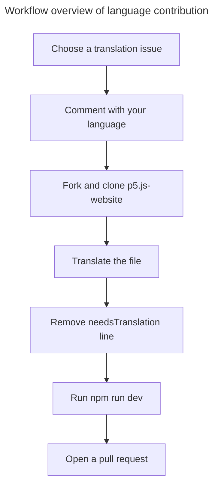
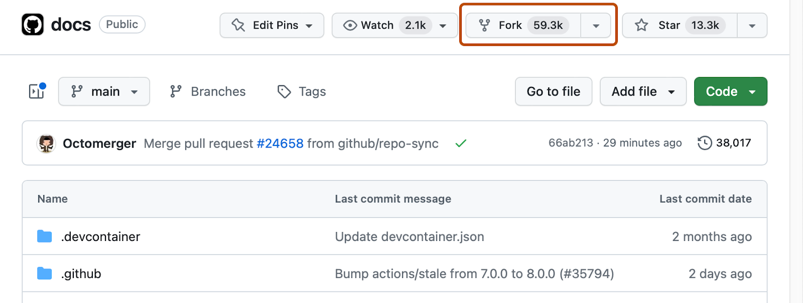
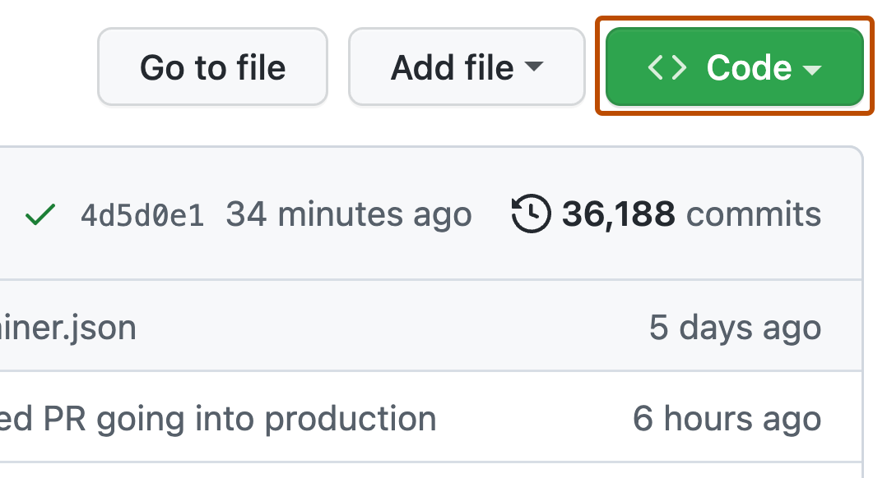

# Translate the p5.js Website

Translation is a great first contribution if you want to contribute to p5.js. You don't need to understand the whole codebase, instead just the language you are translating into in enough.

This page covers finding a translation task, editing the file, previewing locally, and opening a pull request.


## Table of Contents
- [Before you begin](#before-you-begin)
- [Workflow overview](#workflow-overview)
- [1. Fork and clone](#1-fork-and-clone)
- [2. Create a branch](#2-create-a-branch)
- [3. Edit the translation file](#3-edit-the-translation-file)
- [4. Preview locally](#4-preview-locally)
- [5. Commit, push, and open a pull request](#5-commit-push-and-open-a-pull-request)
- [Translation coverage](#translation-coverage)

## Before you begin

1. Read the [Community Statement](https://p5js.org/about/#community-statement).
2. Create a [GitHub account](https://github.com/signup) if you do not have one.
3. See the already existing translation issues on [`processing/p5.js-website`](https://github.com/processing/p5.js-website/issues?q=is%3Aissue+is%3Aopen+label%3A%22needs+translation%22) and you can pick one to work on.
4. Comment on the issue with the language you want to work on (for example, Spanish or Hindi). That helps avoid duplicate work.

Issues may mark a translation as **missing** or **outdated**. Follow the file path listed in the issue.

## Workflow overview



## 1. Fork and clone

1. Open [`processing/p5.js-website`](https://github.com/processing/p5.js-website).
2. Click **Fork** in the upper-right corner.

The second step to work on the p5.js-website translation code is to fork the p5.js-website repository. Forking has a specific meaning in open source, but for our purpose, it means creating a copy of the repository and storing it in your own GitHub account. To fork a repo, simply click on the "Fork" button near the top of the page, and GitHub will make a copy of the repo in your account.



3. Clone your fork 

Once the fork is created, navigate to your fork's page and copy the git URL by clicking the green "Code" button.



Next go to the command line in your local environment and clone this git repository. "Clone" simply means download a copy of the repo to your local machine. Run the following command in a folder where you want to store the p5.js-website source code folder.

```
git clone [git_url]
```

Replace `[git_url]` with the URL you just copied above. This can take several minutes, depending on the speed of your internet connection, a good time to make some coffee! Once the process is finished, you can open up the downloaded folder named `p5.js-website` in your preferred text editor and start looking around.

4. Install dependencies:

```bash
cd p5.js-website
npm install
```
This command helps you move to the right folder, and then install the required dependencies to run the project properly.

## 2. Create a branch

```bash
git checkout -b translation/translate-short-description-es
```

Use a clear name and your language code (`es`, `hi`, `ko`, or `zh-Hans`) for the branch name.

## 3. Edit the translation file

Website content lives under `src/content`. You'll see folders like examples, events, people, etc. English is in `en/`. Translations use the same path with another language folder (and language code):

For example, the corresponding Spanish file for the English file `src/content/examples/en/.../description.mdx` is `src/content/examples/es/.../description.mdx`.

Open the exact path from the issue. If a stub already exists, translate that file instead of creating a new one.

A stub looks roughly like this:

```md
---
title: Color
description: Learn how color works in p5.js.
needsTranslation: true # Remove this entire line after translation is complete
---

Translate the page body here.
```

When you finish:

- Translate the human-readable text.
- Keep Markdown, links, code blocks, and p5.js function names (for example `circle()`, `fill()`).
- **Delete the entire `needsTranslation: true` line**. Do not set it to `false`. While that line is present, the site shows English instead of your draft.

## 4. Preview locally

From the repository root:

```bash
npm install
npm run dev
```

Open the URL shown in the terminal (usually [http://localhost:4321](http://localhost:4321)), switch to your language in the site menu, and open your page.

Confirm that:

- your translation appears (not the English fallback);
- the page loads without errors;
- formatting, links, and code still look right.

Stop the server with `Control + C` on Windows, Mac, and Linux when you are done.

## 5. Commit, push, and open a pull request

```bash
git status
git add path/to/your/translated-file.mdx
git commit -m "docs: update Spanish translation for the color example"
git push -u origin translation/translate-short-description-es
```

On GitHub, open a pull request into `processing/p5.js-website`.

In the PR description:

- say which language and page you translated;
- link the issue (`Addresses #1234`);
- note that you ran `npm run dev` and verified the translation.

A maintainer or language steward may leave review comments. Push updates to the same branch, the PR updates automatically. And the review and update loop can run.

## Translation coverage

You can see overall translation progress in this p5.js sketch:

- [Translation coverage visualization](https://editor.p5js.org/aashishpanthi/sketches/1nNkSHrUe)

After the coverage workflow is live on the site, the data will also be available at: [https://p5js.org/translation-status/coverage.json](https://p5js.org/translation-status/coverage.json).


> For routes, UI strings, English fallback, and how localization works in the website code, see the [localization documentation](https://github.com/processing/p5.js-website/blob/main/docs/localization.md).

Questions are welcome on the issue or pull request. Ask rather than guess when wording or technical terms are unclear.
